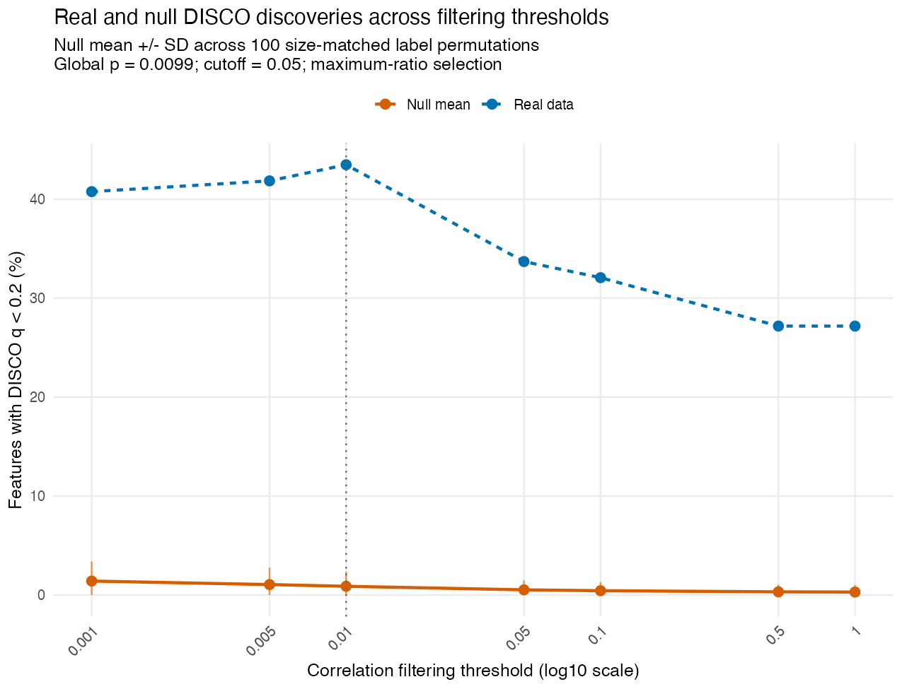
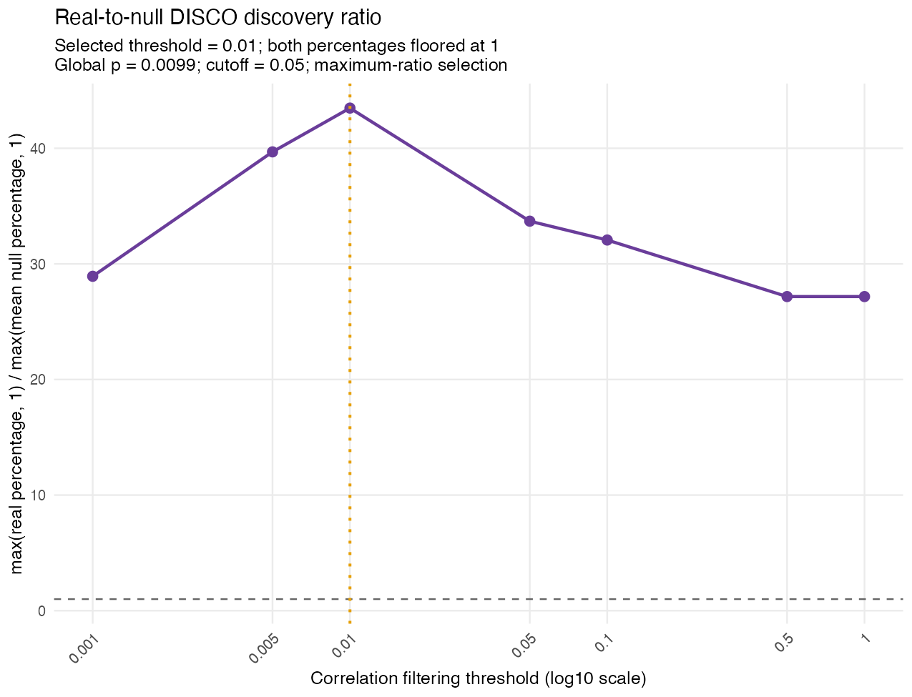
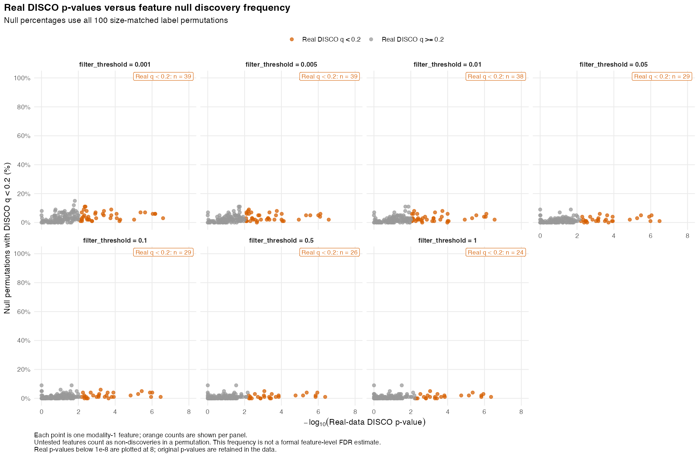
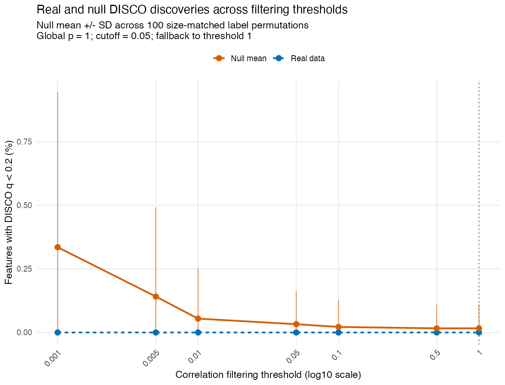
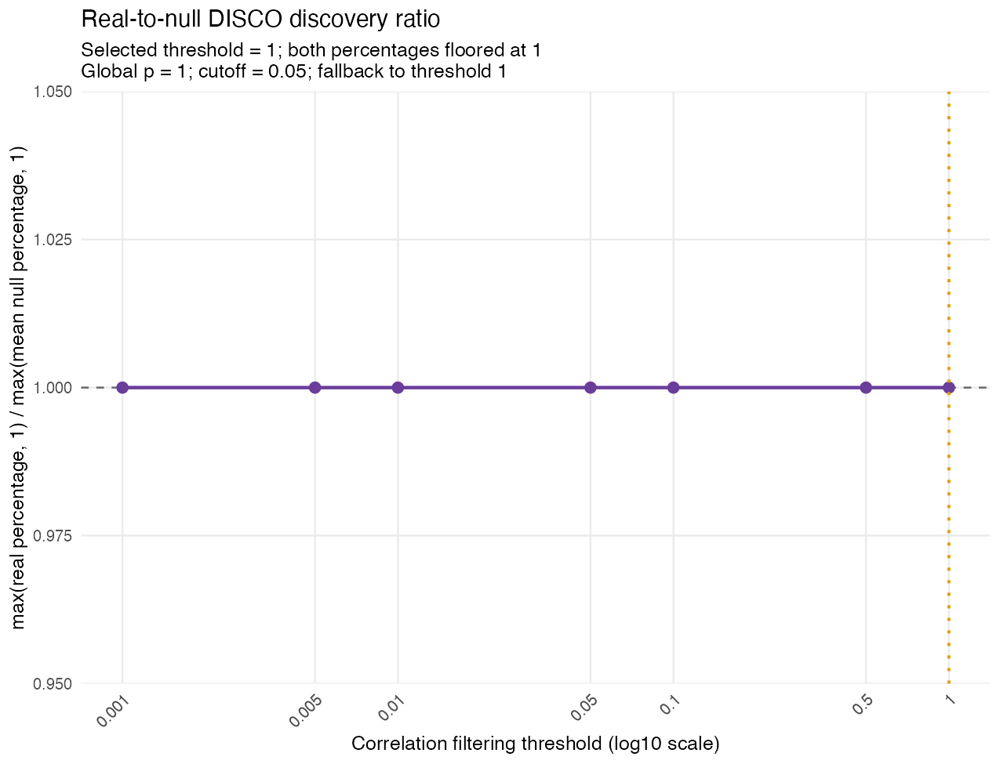
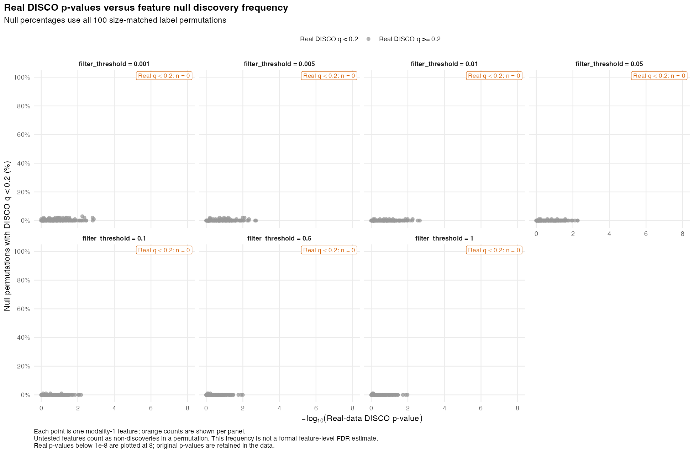

---
output:
  github_document:
    html_preview: false
    toc: false
---

```{r setup, include=FALSE}
knitr::opts_chunk$set(collapse = TRUE, comment = "#>", message = FALSE, warning = FALSE)
readme_results <- readRDS("README-results.rds")
source("analysis/yachida_readme_preprocessing.R")
if (!identical(readme_results$source_md5, readme_source_hashes(normalizePath(".")))) {
  stop("Example code has changed. Run Rscript analysis/run_yachida_readme_examples.R before rendering.")
}
knitr::read_chunk("analysis/run_yachida_readme_examples.R")
knitr::read_chunk("analysis/yachida_readme_preprocessing.R")
example_chunks <- c("readme-settings", "retrieve-taxa", "readme-preprocess-helper",
                    "readme-residual-helper", "run-taxa", "run-two-modalities")
for (label in example_chunks) {
  if (!nzchar(paste(knitr::knit_code$get(label), collapse = "\n"))) {
    stop("Missing analysis source chunk: ", label)
  }
}
example_q <- format(readme_results$settings$q_value)
example_prevalence <- 100 * readme_results$settings$prevalence_cutoff
top_taxa_table <- function(x) {
  x$p <- format(x$p, digits = 3, scientific = TRUE)
  x$q <- format(x$q, digits = 3, scientific = TRUE)
  knitr::kable(x, row.names = FALSE,
               col.names = c("Taxon", "DISCO p", "DISCO q", "Comparisons"))
}
```

# DISCO

<!-- README.md is generated from README.Rmd. Please edit README.Rmd. -->

DISCO (**DIS**ruption in **CO**rrelations) identifies features whose correlation
patterns differ between two groups. It evaluates relationships within one data
modality or between two modalities and combines pairwise tests into a
feature-level DISCO score.

DISCO can be applied to **any high-dimensional data represented by quantitative
features**, including microbial abundances, gene expression, proteins, and
metabolites. It uses Spearman correlations with Bonett–Wright standard errors
and Cauchy combination of differential-correlation p-values.

## Installation

```{r install, eval=FALSE}
install.packages("remotes") # If needed
remotes::install_github("FarnazFouladi/DISCO")
library(DISCO)
```

To use a local checkout during development, run `devtools::load_all(".")` from
the repository root.

## Inputs and arguments

`data1` and `data2` represent the two groups. Each is a list containing one or
two numeric matrices or data frames, with **samples in rows and features in
columns**. Supply unique feature names and, especially for two modalities,
unique sample row names. Corresponding modalities are restricted to common
features and put in a consistent order.

**Normalize inputs appropriately for the data type before running DISCO.**
The function does not normalize or adjust for covariates. CLR is used for the
compositional abundance examples below; other data types require their own
appropriate preprocessing. Supply covariate-adjusted data if your analysis
requires it. Zeros are observed values; only `NA` reduces the pairwise-complete
sample count.

| Argument | Default | Meaning |
|---|---:|---|
| `cooccur` | `10` | Minimum pairwise non-missing observations in **each** group; integer ≥4. |
| `empirically_derive_threshold` | `TRUE` | Select the correlation filtering threshold using label permutations. |
| `filter_threshold` | `0.05` | Fixed correlation p-value threshold when empirical selection is disabled. |
| `q_value` | `0.2` | Feature-level DISCO q cutoff for real and null discovery counts and plot colors. |
| `global_p_cutoff` | `0.05` | Global permutation p-value must be below this cutoff to select by ratio; otherwise use threshold `1`. |
| `n_resamples` | `100` | Number of size-matched label permutations. |
| `random_seed` | `1L` | Reproducible permutation seed; the caller's RNG state is restored. |
| `adj_method` | `"BY"` | Multiple-testing adjustment passed to `p.adjust()`. |
| `output_dir`, `prefix` | Required | Results directory and filename prefix. |

Empirical mode evaluates `c(0.001, 0.005, 0.01, 0.05, 0.1, 0.5, 1)`.
A pair passes a threshold when its correlation p-value is below it in at least
one group. DISCO first compares the maximum real discovery percentage across
thresholds with the maximum from each permutation:

```text
global p = (1 + number of null maxima >= real maximum) / (1 + valid permutations)
```

If the global test passes, DISCO selects the threshold maximizing
`max(real %, 1) / max(mean null %, 1)`; ties select the largest threshold.
Otherwise it uses threshold `1`. With 100 permutations, the smallest possible
global p-value is `1/101`. Thresholds without a real discovery percentage are
excluded from both maxima; permutations missing any remaining threshold are
excluded from the global test. Counts used are reported in `global_test`.
The function stops if no thresholds or valid permutations remain.

For a fixed threshold, set `empirically_derive_threshold = FALSE` and supply
`filter_threshold`. This skips permutations and diagnostic plots.

## Returned results

| Component | Contents |
|---|---|
| `cor_diff` | Feature pairs, correlations `r1`/`r2`, counts `n1`/`n2`, and differential-correlation `p`/`q`, sorted by increasing `q`. |
| `disco` | Feature-level scores (`t`), p-values, q-values, and comparison counts (`num_corr`), sorted by increasing `q`. |
| `selected_threshold` | Selected empirical threshold or supplied fixed threshold. |
| `global_test` | Global p-value, cutoff, signal decision, permutation counts, and selected threshold. |
| `threshold_summary` | Real/null discovery percentages, null SD, floored percentages, and ratios across thresholds. |
| `discovery_plot`, `ratio_plot` | Real versus null discovery curves and their ratio. |
| `feature_null_summary`, `feature_null_plot` | Per-feature null discovery frequencies versus real p-values, across thresholds. |
| `output_files` | Paths to saved CSV tables and PNG figures. |

In two-modality mode, DISCO tests **cross-modality pairs** and scores features
in the **first modality**. Samples may differ between modalities; permutations
preserve each modality's group sizes and overlap. A shared sample receives one
shuffled label for both modalities.

In `feature_null_summary`, `q_less_than_0.2` indicates a real-data DISCO
`q < 0.2`; its name follows `q_value`. Null discovery percentages use all
permutations as the denominator, counting untested features as non-discoveries.
These frequencies are not formal feature-level FDR estimates. The plots display
real p-values below `1e-8` at `-log10(p) = 8`; original p-values are retained.
The global test accounts for searching across thresholds but does not adjust
feature-level q-values for threshold selection.

Fixed mode returns the first three components and `output_files`; the
diagnostic components are `NULL`. Pair and feature tables are saved as
`<prefix>_cor_diff.csv` and `<prefix>_disco.csv`.

## Yachida example: taxa

We use healthy controls and CRC samples from
[Yachida et al. (2019)](https://www.nature.com/articles/s41591-019-0458-7),
accessed through
[curatedMetagenomicData](https://waldronlab.io/curatedMetagenomicData/reference/returnSamples.html).
This example uses:

- Relative abundances (`counts = FALSE`).
- Features present in **≥`r example_prevalence`% of samples in each group**:
  a feature must pass separately in both healthy controls and CRC.
- Zero replacement with **half each feature's minimum positive abundance**,
  estimated across that cohort after prevalence filtering.
- **CLR normalization** within each sample, separately for each modality.
- After CLR, each feature is residualized against **age, gender, and BMI** using
  **separate models within healthy controls and CRC**. Each group has its own
  intercept and covariate coefficients. Models are fitted once within the
  original groups; the resulting residuals feed the real comparison and all
  label permutations, without refitting the covariate models after shuffling.
- `r readme_results$settings$n_resamples` label permutations, q cutoff
  `r example_q`, and global p-value cutoff `r readme_results$settings$global_p_cutoff`.

Install the example dependencies if needed:

```{r example-install, eval=FALSE}
install.packages("BiocManager")
BiocManager::install(c("curatedMetagenomicData", "SummarizedExperiment"))
```

### Retrieve and preprocess the data

The blocks below are read directly from the
[analysis script](analysis/run_yachida_readme_examples.R) and its
[helpers](analysis/yachida_readme_preprocessing.R). The script initializes the
local package and repository paths (`analysis_dir`, `repo_dir`), then runs these
exact blocks. Cached runs are reused only when inputs, settings, and source-code
hashes match.

```{r readme-settings, eval=FALSE}
```

Samples missing age, gender, or BMI are excluded **before prevalence filtering
and normalization**. The excluded-sample table is saved with the analysis.

```{r retrieve-taxa, eval=FALSE}
```

The same preprocessing helper is used for taxa and pathways:

```{r readme-preprocess-helper, eval=FALSE}
```

The covariate-adjustment helper fits a separate response model for each feature
within each group. Residuals keep the original sample and feature names.

```{r readme-residual-helper, eval=FALSE}
```

```{r run-taxa, eval=FALSE}
```

### Results

These outputs come from the completed analysis, saved before rendering this
README. Package version: `r readme_results$versions[["DISCO"]]`;
curatedMetagenomicData version: `r readme_results$versions[["curatedMetagenomicData"]]`.
Downloading a different resource version can change results.
The complete-case restriction excluded
**`r readme_results$excluded_covariate_samples`** sample(s) with missing covariates.

```{r taxa-cohort, echo=FALSE}
knitr::kable(readme_results$taxa$cohort[, c("control", "CRC", "retained_taxa")],
             row.names = FALSE)
```

Global p-value: **`r format(readme_results$taxa$global_test$global_p_value, digits=4)`**.
Selected threshold: **`r readme_results$taxa$selected_threshold`**.
Taxa with DISCO q <`r example_q` at the selected threshold:
**`r readme_results$taxa$significant_taxa`**.

Top 10 taxa by DISCO q-value, breaking ties by p-value:

```{r taxa-top, echo=FALSE}
top_taxa_table(readme_results$taxa$top_taxa)
```

The first plot compares real discovery percentages with the null mean ± SD.
The second shows the ratio used to select the threshold.

```{r taxa-discoveries, echo=FALSE, out.width="100%"}

```

```{r taxa-ratios, echo=FALSE, out.width="100%"}

```

Each point below is a taxon. Orange denotes real-data DISCO q <`r example_q`; each panel
reports its orange-taxon count. The y-axis is the percentage of null permutations
in which that taxon had DISCO q <`r example_q`.

```{r taxa-features, echo=FALSE, out.width="100%"}

```

## Yachida example: taxa and pathways

We now compare **taxon–pathway correlations** between CRC and healthy controls.
The first modality is taxa, so the DISCO scores describe taxa whose relationships
with pathways differ between groups. Pathways are unstratified community totals;
`UNMAPPED` and `UNINTEGRATED` rows are removed. Both modalities are restricted to
common usable samples, then prevalence-filtered and normalized separately using
the same ≥`r example_prevalence`%, half-minimum, CLR workflow above. **Both taxa and pathways** are
then residualized against age, gender, and BMI separately within each group,
and DISCO compares correlations between those residuals.

```{r run-two-modalities, eval=FALSE}
```

### Results

```{r two-cohort, echo=FALSE}
knitr::kable(readme_results$taxa_pathways$cohort, row.names = FALSE)
```

Global p-value: **`r format(readme_results$taxa_pathways$global_test$global_p_value, digits=4)`**.
Selected threshold: **`r readme_results$taxa_pathways$selected_threshold`**.
Taxa with DISCO q <`r example_q` at the selected threshold:
**`r readme_results$taxa_pathways$significant_taxa`**.

`r if (!readme_results$taxa_pathways$global_test$signal_detected) "The global test does not detect excess discoveries in this taxon–pathway analysis, so DISCO falls back to threshold 1." else "The global test detects excess discoveries, so DISCO selects the threshold by the real-to-null ratio."`
The table below shows the top 10 taxa by DISCO q-value, breaking ties by
p-value. A ranking alone does not establish significance; use the reported q-values.

```{r two-top, echo=FALSE}
top_taxa_table(readme_results$taxa_pathways$top_taxa)
```

```{r two-discoveries, echo=FALSE, out.width="100%"}

```

```{r two-ratios, echo=FALSE, out.width="100%"}

```

```{r two-features, echo=FALSE, out.width="100%"}

```

## Rebuilding these examples

`README.Rmd` is the source for this README. Rendering reads the portable saved
summaries in `README-results.rds` and figures under `man/figures/`; it does not
download data or rerun permutations. Analysis code blocks are imported from the
script with `knitr::read_chunk()`, so they are never maintained separately in
the Rmd. Rendering stops if source-code hashes differ from the saved results,
preventing changed code from being shown with stale outputs. From the repository root:

```{r render, eval=FALSE}
install.packages(c("rmarkdown", "knitr")) # If needed; Pandoc is also required
rmarkdown::render("README.Rmd")
```

To regenerate the analysis outputs and README assets with the current local
package, run:

```sh
Rscript analysis/run_yachida_readme_examples.R
```

This requires the example dependencies and `pkgload`, may download resources
through ExperimentHub, and reuses existing results only when inputs and settings
and source hashes match. Set `DISCO_README_RECOMPUTE=true` to recompute both
examples. Results stay under `analysis/yachida_readme_groupwise_10pct_results/`;
previous pooled-adjustment and unadjusted results are retained. The README bundle contains only cohort summaries and
top-result tables. Package checks can be run with `devtools::test()` and
`devtools::check()`.
Preprocessing and residualization helpers can be checked without downloading
data using `Rscript analysis/test_yachida_readme_helpers.R`.

## License

DISCO is licensed under the MIT License.
