---
output:
  github_document:
    html_preview: false
    toc: false
---

```{r setup, include=FALSE}
knitr::opts_chunk$set(collapse = TRUE, comment = "#>", message = FALSE, warning = FALSE)
readme_results <- readRDS("analysis/diabetes_microbiome/results/README-results.rds")
knitr::read_chunk("analysis/diabetes_microbiome/code/run_qinj_readme_examples.R")
knitr::read_chunk("analysis/diabetes_microbiome/code/qinj_readme_preprocessing.R")
knitr::read_chunk("analysis/ibd_transcriptomics/code/example_ibd_workflow.R")
example_chunks <- c("readme-package", "readme-settings", "readme-select-helper", "retrieve-taxa", "readme-preprocess-helper",
                    "readme-residual-helper", "run-taxa", "run-two-modalities")
for (label in example_chunks) {
  if (!nzchar(paste(knitr::knit_code$get(label), collapse = "\n"))) {
    stop("Missing analysis source chunk: ", label)
  }
}
example_q <- format(readme_results$settings$q_value)
example_prevalence <- 100 * readme_results$settings$prevalence_cutoff
example_results <- lapply(c("taxa", "taxa_pathways"), function(mode) {
  readRDS(file.path("analysis/diabetes_microbiome/results", mode, "disco_analysis.rds"))
})
names(example_results) <- c("taxa", "taxa_pathways")
example_significant <- lapply(example_results, function(result) {
  result$disco$species[is.finite(result$disco$q) & result$disco$q < readme_results$settings$q_value]
})
example_union <- length(Reduce(union, example_significant))
example_overlap <- length(Reduce(intersect, example_significant))
example_pairs <- list(
  taxa = read.csv("analysis/diabetes_microbiome/results/differential_scatterplots/top10_pairs.csv"),
  taxa_pathways = read.csv("analysis/diabetes_microbiome/results/taxa_pathway_scatterplots/top1_pairs.csv"))
ibd_dir <- "analysis/ibd_transcriptomics/results"
ibd_provenance <- readRDS(file.path(ibd_dir, "provenance.rds"))
ibd_settings <- ibd_provenance$settings
ibd_plot_settings <- readRDS(file.path(ibd_dir, "figure/plot_settings.rds"))
ibd_samples <- read.csv(file.path(ibd_dir, "comparison_sample_counts.csv"))
ibd_percentages <- read.csv(file.path(ibd_dir, "figure/pathway_significance_percentages.csv"))
ibd_displayed <- read.csv(file.path(ibd_dir, "figure/pathway_order.csv"))
ibd_q <- format(ibd_plot_settings$q_cutoff)
ibd_n_pathways <- length(ibd_provenance$pathways)
ibd_n_displayed <- nrow(ibd_displayed)
ibd_comparisons <- ibd_settings$comparisons
ibd_samples <- ibd_samples[match(ibd_comparisons, ibd_samples$comparison), ]
ibd_group_names <- c(iCD = "Ileal Crohn's disease", cCD = "Colon-only Crohn's disease",
                     UC = "Ulcerative colitis", CD = "Crohn's disease")
ibd_sample_table <- data.frame(
  Comparison = paste0(unname(ibd_group_names[ibd_samples$comparison]), " (", ibd_samples$comparison, ")"),
  `Disease samples` = ibd_samples$n_disease, `Non-IBD controls` = ibd_samples$n_control,
  check.names = FALSE)
ibd_inflammation <- ibd_percentages[ibd_percentages$pathway == "HALLMARK_INFLAMMATORY_RESPONSE", ]
ibd_inflammation <- ibd_inflammation[match(ibd_comparisons, ibd_inflammation$comparison), ]
disco_taxa_table <- function(x) {
  x <- x[is.finite(x$q) & x$q < readme_results$settings$q_value, , drop = FALSE]
  x <- x[order(x$q, x$p, x$species), c("species", "p", "q", "num_corr")]
  x$p <- format(x$p, digits = 3, scientific = TRUE)
  x$q <- format(x$q, digits = 3, scientific = TRUE)
  knitr::kable(x, row.names = FALSE,
    col.names = c("Taxon", "DISCO p", "DISCO q", "Pairs"))
}

```

# DISCO

<!-- README.md is generated from README.Rmd. Please edit README.Rmd. -->

**On this page**

- [Installation](#installation)
- [Inputs and arguments](#inputs-and-arguments)
- [Outputs](#outputs)
- [Quick start](#quick-start)
- [Examples of DISCO application](#disco-application)
- [Example 1: Microbiome, one modality](#example-of-one-data-modality-taxontaxon-correlations-in-type-2-diabetes)
- [Example 2: Microbiome, two modalities](#example-of-two-data-modalities-taxonpathway-correlations)
- [Example 3: IBD transcriptomics](#transcriptomics-example-gene-correlations-within-ibd-hallmark-pathways)
- [Citation](#citation)

DISCO (**DIS**ruption in **CO**rrelations) is an exploratory tool that attempts to
identify features whose correlation patterns differ between two groups, such as
healthy controls and people with a disease. It combines evidence from pairwise
differential-correlation tests into a score, p-value, and adjusted p-value
(q-value) for each feature. This helps
identify features whose relationships with other features differ between
groups, even when their average abundances are similar.

DISCO supports one modality (for example, correlations among microbial taxa)
or two modalities (for example, correlations between microbes and metabolites).
It can be applied to high-dimensional data, including microbiome,
transcriptomic, and metabolomic measurements. Normalize data appropriately
for the data type before applying DISCO.

DISCO uses Spearman correlations with Fisher transformations and
[Bonett–Wright standard errors (2000)](https://doi.org/10.1007/BF02294183),
then combines differential-correlation p-values using the
[Cauchy combination test (Liu and Xie, 2020)](https://doi.org/10.1080/01621459.2018.1554485).

## Installation

```{r install, eval=FALSE}
install.packages("remotes") # If needed
remotes::install_github("FarnazFouladi/DISCO")
library(DISCO)
```

## Inputs and arguments

The main function, `disco()`, compares `data1` (group 1, such as controls) with
`data2` (group 2, such as cases). Each input is a list containing **one or two
numeric matrices or data frames**, with **samples in rows and features in
columns**.

- **One modality:** DISCO compares correlations among features and assigns a
  score to each feature based on its differential correlations with the others.
- **Two modalities:** DISCO compares cross-modality correlations and scores
  features in the **first modality**. For example, list microbes first and
  metabolites second to score microbes by changes in their metabolite
  associations. Use the same modality order in both groups.

DISCO matches features between groups by column name within each modality.
It keeps shared features and reorders group 2 to match group 1.

For two modalities, row names must identify samples consistently. Within each
group, the modalities must share samples, but their sample sets and row order
may differ. DISCO aligns rows by sample name and represents measurements from
an unavailable modality as missing. Each feature pair must have at least
`cooccur` paired, nonmissing observations **in each group** to be tested.

**Normalize inputs appropriately before running DISCO.** The function does not
normalize data or adjust for covariates. Supply normalized and, when needed,
covariate-adjusted measurements. In the examples below, we use a robust centred
log-ratio (CLR) transformation for microbiome data: each sample is centred over
its observed positive features, and abundance zeros are represented as `NA`.
DISCO then uses complete observations separately for each feature pair. Other
data types may require different preprocessing. DISCO itself treats numeric zeros as observed
values; missing values are excluded separately for each pair. If zeros should
be excluded from the correlation calculations, represent them as `NA` before
running DISCO.

| Argument | Default | Meaning |
|---|---:|---|
| `cooccur` | `20` | Minimum number of pairwise nonmissing observations in **each** group; integer ≥10. |
| `empirically_derive_threshold` | `TRUE` | Select the correlation filtering threshold using label permutations. |
| `filter_threshold` | `1` | Fixed correlation p-value threshold when empirical selection is disabled. |
| `q_value` | `0.2` | Feature-level q-value cutoff used to count discoveries in empirical mode. |
| `global_p_cutoff` | `0.05` | Select a threshold by the real-to-null ratio only when the global permutation p-value is below this cutoff; otherwise use `1`. |
| `n_resamples` | `100` | Number of size-matched label permutations. |
| `random_seed` | `1L` | Reproducible permutation seed; the caller's RNG state is restored. |
| `adj_method` | `"BY"` | Multiple-testing adjustment passed to `p.adjust()`. |
| `workers` | `1L` | Number of parallel workers for permutations; capped at `n_resamples`. |
| `output_dir`, `prefix` | Required | Results directory and filename prefix. |

### Correlation filtering and threshold selection

DISCO estimates a Spearman correlation for each eligible pair in each group,
tests whether the correlations differ, and combines the raw differential-test
p-values separately for each focal feature. In high-dimensional data, the
number of feature pairs can be large. Screening out weak correlations can
reduce the number of uninformative pairs contributing to a score and may
increase power, although it can also increase false positives.
`filter_threshold` screens pairs using their **single-group correlation
p-values**, not their differential-correlation p-values. A pair is retained if
its correlation p-value is below the threshold in **at least one group**. For
example, `filter_threshold = 0.05` excludes pairs whose correlation p-values are
≥0.05 in both groups. A threshold of `1` is the least restrictive setting.

To choose a threshold empirically, DISCO
(`empirically_derive_threshold = TRUE`, the default) compares the observed
data with size-matched random label permutations at filtering thresholds
`c(0.001, 0.005, 0.01, 0.05, 0.1, 0.5, 1)`. At each threshold, it calculates
the percentage of tested features with DISCO `q < q_value` in the observed data
and in each permutation. A global permutation test then compares the maximum
observed discovery percentage across thresholds with the corresponding maximum
from each valid permutation:

```text
global p = (1 + number of null maxima >= real maximum) / (1 + valid permutations)
```

If `global p < global_p_cutoff`, DISCO selects the threshold that maximizes
`max(real percentage, 1) / max(mean null percentage, 1)`. The floors are in
percentage points and prevent ratios from being dominated by near-zero values.
Ties select the largest threshold. If `global p >= global_p_cutoff`, DISCO uses
threshold `1`.

For two modalities, permutations preserve each modality's group sizes and
sample overlap. A shared sample receives the same shuffled group label in both
modalities.

To use a fixed threshold, set `empirically_derive_threshold = FALSE` and supply
`filter_threshold` (default `1`). This skips permutations and diagnostic plots.

## Quick start

Here is a self-contained toy example with 30 samples per group and five
features to illustrate how to run DISCO. In this example, features 1 and 2
are correlated in controls but independent in cases. These simulated values
represent preprocessed data.

```{r fixed-example, eval=FALSE}
# A toy example
library(DISCO)

set.seed(1)
controls <- matrix(rnorm(30 * 5), nrow = 30, ncol = 5)
cases <- matrix(rnorm(30 * 5), nrow = 30, ncol = 5)
colnames(controls) <- colnames(cases) <- paste0("feature", 1:5)
controls[, 2] <- controls[, 1] + rnorm(30, sd = 0.2)

result <- disco(
  data1 = list(controls),
  data2 = list(cases),
  cooccur = 20,
  empirically_derive_threshold = FALSE, # empirical mode is turned off
  filter_threshold = 1,
  q_value = 0.2,       # Used only in empirical mode
  n_resamples = 100,  # Used only in empirical mode
  random_seed = 1L,   # Used only in empirical mode
  adj_method = "BY",
  output_dir = "disco_results",
  prefix = "controls_vs_cases",
  global_p_cutoff = 0.05, # Used only in empirical mode
  workers = 1L           # Used only in empirical mode
)
```

## Outputs

| Component | Contents |
|---|---|
| `cor_diff` | Feature pairs, correlations `r1`/`r2`, counts `n1`/`n2`, and differential-correlation `p`/`q`, sorted by increasing `q`. |
| `disco` | Feature-level scores (`t`), p-values, q-values, and comparison counts (`num_corr`), sorted by increasing `q`. |
| `selected_threshold` | Selected empirical threshold or supplied fixed threshold. |
| `global_test` | Global p-value, cutoff, signal decision, permutation counts, and selected threshold. |
| `threshold_summary` | Real/null discovery percentages, null SD, floored percentages, and ratios across thresholds. |
| `discovery_plot`, `ratio_plot` | Real versus null discovery curves and their ratio. |
| `feature_null_summary`, `feature_null_plot` | Per-feature null discovery frequencies versus real p-values, across thresholds. |
| `output_files` | Paths to saved CSV tables and PNG figures. |

In `feature_null_summary`, a column such as `q_less_than_0.2` indicates whether
the real-data feature q-value is below `0.2`. The column name reflects the
supplied `q_value`. For each feature, its null discovery frequency is the
percentage of all requested permutations in which it has DISCO q < `q_value`.
Permutations in which that feature is absent or untested contribute zero to its
discovery count.

`feature_null_plot` shows **−log10(real-data p-value)** on the x-axis and the
percentage of permutations in which the feature has `q < q_value` on the
y-axis. Orange points identify real-data discoveries. Low null discovery
frequencies provide a useful diagnostic, but are not formal feature-level FDR
estimates.

In fixed mode, `cor_diff`, `disco`, `selected_threshold`, and `output_files` are
returned; the diagnostic components are `NULL`. Pair-level and feature-level tables are
saved as `<prefix>_cor_diff.csv` and `<prefix>_disco.csv`.


## Examples of DISCO application

Here we illustrate the application of DISCO to microbiome and transcriptomic data.
The example files are organized by dataset under `analysis/`:

```text
analysis/
  diabetes_microbiome/
    code/       # QinJ preprocessing, DISCO, plotting, and README scripts
    results/    # Saved analyses, tables, plot data, and figures
  ibd_transcriptomics/
    code/       # Metadata retrieval, preprocessing, DISCO, and plotting
    results/    # Saved analyses and figures; input snapshots in inputs/
```


## Example of one data modality: taxon–taxon correlations in type 2 diabetes

This example uses **QinJ_2012** from [Qin et al. (2012)](https://doi.org/10.1038/nature11450),
comparing type 2 diabetes (**T2D**) with healthy controls in
`curatedMetagenomicData`. Both the one-modality and two-modality examples use
this same comparison.

Dataset reference: Qin J, Li Y, Cai Z, et al. **A metagenome-wide association
study of gut microbiota in type 2 diabetes.** *Nature*. 2012;490:55–60.
[doi:10.1038/nature11450](https://doi.org/10.1038/nature11450).

The workflow follows these steps:

1. Select one independent sample per participant, excluding conflicting disease
   labels and samples missing **gender or BMI**.
2. Retain features present in **≥`r example_prevalence`% of each group**, testing
   prevalence separately in controls and T2D.
3. Apply **robust CLR** within each sample, centring log positive abundances
   over the retained observed features. Abundance zeros and existing missing
   values remain `NA`; no zero imputation is performed.
4. Fit **`~ gender + BMI` separately within controls and T2D**,
   using each feature's observed values. Gender is categorical and BMI is
   continuous. Preserve missing residuals.
5. Run DISCO on the residuals, using complete observations separately for each
   pair and requiring at least **`r readme_results$settings$cooccur` observations
   in each group**.

The saved run uses **`r readme_results$settings$n_resamples` permutations**,
`r readme_results$settings$workers` workers, seed
`r readme_results$settings$random_seed`, BY adjustment, feature q <
`r example_q`, and global p < `r readme_results$settings$global_p_cutoff`.

### Retrieve and preprocess the data

Install the data dependencies if needed:

```{r example-install, eval=FALSE}
install.packages("BiocManager")
BiocManager::install(c("curatedMetagenomicData", "SummarizedExperiment"))
```

The following blocks are imported directly from the
[analysis script](https://github.com/FarnazFouladi/DISCO/blob/main/analysis/diabetes_microbiome/code/run_qinj_readme_examples.R) and
[preprocessing helpers](https://github.com/FarnazFouladi/DISCO/blob/main/analysis/diabetes_microbiome/code/qinj_readme_preprocessing.R).

Load the installed DISCO package (see Installation above):

```{r readme-package, eval=FALSE}
```

```{r readme-settings, eval=FALSE}
```

The selection helper handles independent participants and complete covariates:

```{r readme-select-helper, eval=FALSE}
```

```{r retrieve-taxa, eval=FALSE}
```

Prevalence filtering and robust CLR are applied independently to each modality:

```{r readme-preprocess-helper, eval=FALSE}
```

Each feature is adjusted separately within each group using its observed values:

```{r readme-residual-helper, eval=FALSE}
```

Run taxa-only DISCO using the adjusted residuals:

```{r run-taxa, eval=FALSE}
```

### DISCO results

Package versions: DISCO `r readme_results$versions[["DISCO"]]` and
curatedMetagenomicData `r readme_results$versions[["curatedMetagenomicData"]]`.
The saved analysis excluded **`r readme_results$excluded_covariate_samples`**
samples with incomplete covariates.

```{r taxa-cohort, echo=FALSE}
knitr::kable(readme_results$taxa$cohort[, c("control", "T2D", "retained_taxa")],
  row.names = FALSE)
```

**`r readme_results$taxa$significant_taxa` taxa have DISCO q < `r example_q`.**
The table lists these taxa. “Pairs” counts the feature pairs contributing to each
taxon's DISCO score. These taxa show evidence of altered correlation patterns
between controls and T2D cases.

```{r taxa-top, echo=FALSE}
disco_taxa_table(example_results$taxa$disco)
```

### Diagnostics for threshold selection

The global permutation p-value is
**`r format(readme_results$taxa$global_test$global_p_value, digits=4)`**.
`r if (readme_results$taxa$global_test$signal_detected) "The global test detects excess discoveries, so DISCO selects the threshold using the maximum real-to-null discovery ratio." else "The global test does not pass, so DISCO uses the fallback threshold of 1."`
The selected correlation-filtering threshold is
**`r readme_results$taxa$selected_threshold`**.

The discovery plot compares observed discovery percentages with the permutation
mean ± SD. The ratio plot shows the criterion used for threshold selection.

```{r taxa-discoveries, echo=FALSE, out.width="100%"}
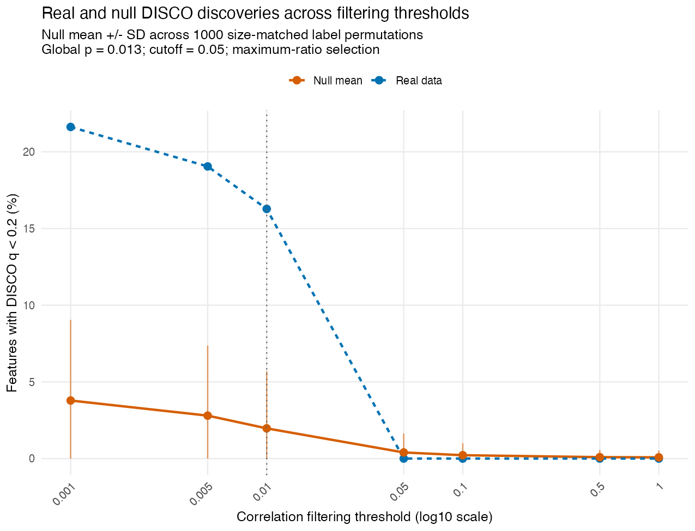
```

```{r taxa-ratios, echo=FALSE, out.width="100%"}
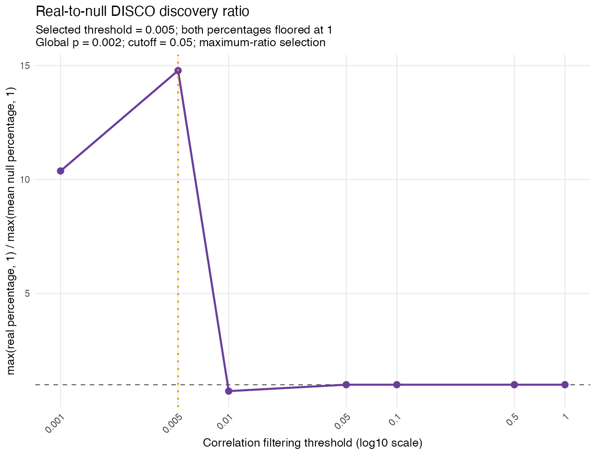
```

The following feature diagnostic shows −log10(raw DISCO p) against the percentage of
permutations with DISCO q < `r example_q`, separately at each filtering
threshold. Orange points are real-data discoveries. Null discovery percentages
are diagnostics, not formal feature-level FDR estimates. We can see that at the
selected threshold **`r readme_results$taxa$selected_threshold`**, the significant DISCO
taxa have a low null discovery percentage (less than 5%).

```{r taxa-features, echo=FALSE, out.width="100%"}

```

### Taxon–taxon network

For taxa with significant DISCO scores, we can extract their pairwise correlations
from the `cor_diff` output to visualize how their correlations with other taxa
differ between groups. For example, the network highlights the
**top ten significant taxa**, ranked by DISCO q, then p. Edges are selected by
**raw differential-correlation p < 0.05** from
the saved pair table after DISCO's selected correlation filter. The panels share nodes,
edges, and positions across the two groups; red/blue indicate positive/negative group correlations,
and edge width shows |Spearman r|. Edge presence does not imply within-group
correlation significance.

Correlation source:
[QinJ_2012_taxa_cor_diff.csv](https://github.com/FarnazFouladi/DISCO/blob/main/analysis/diabetes_microbiome/results/taxa/QinJ_2012_taxa_cor_diff.csv).
Its columns identify the pair (`t1`, `t2`), control/T2D Spearman correlations
(`r1`, `r2`), complete-pair sample counts (`n1`, `n2`), and differential-correlation
`p` and `q`. The exact subset drawn as edges is saved in
[network_edges.csv](https://github.com/FarnazFouladi/DISCO/blob/main/analysis/diabetes_microbiome/results/taxa_networks/network_edges.csv).

```{r taxa-network, echo=FALSE, out.width="100%"}
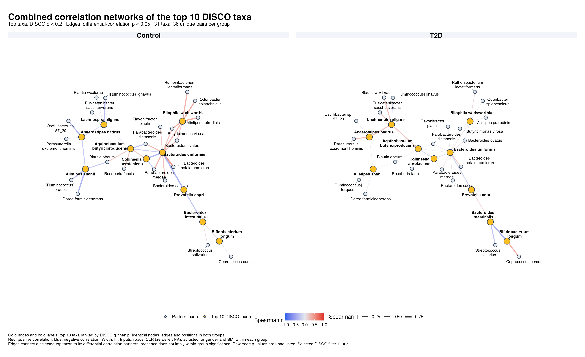
```

### Example pairwise scatterplot

Scatterplots show the group-specific relationship for an individual feature
pair. The highest-ranked retained pair is **`r example_pairs$taxa$t1[1]` versus
`r example_pairs$taxa$t2[1]`**, ranked by differential-correlation q, then p. The plot
uses the exact adjusted inputs passed to DISCO and only complete pairs. Its
annotations report the saved Spearman correlations and paired sample counts
from `cor_diff`. Dashed linear fits are visual guides.

Pair statistics come from
[QinJ_2012_taxa_cor_diff.csv](https://github.com/FarnazFouladi/DISCO/blob/main/analysis/diabetes_microbiome/results/taxa/QinJ_2012_taxa_cor_diff.csv);
the selected pairs and their annotations are exported in
[top10_pairs.csv](https://github.com/FarnazFouladi/DISCO/blob/main/analysis/diabetes_microbiome/results/differential_scatterplots/top10_pairs.csv).
The plotted sample values are exported in
[scatterplot_data.csv](https://github.com/FarnazFouladi/DISCO/blob/main/analysis/diabetes_microbiome/results/differential_scatterplots/scatterplot_data.csv),
extracted from the adjusted matrices in
[disco_inputs.rds](https://github.com/FarnazFouladi/DISCO/blob/main/analysis/diabetes_microbiome/results/taxa/disco_inputs.rds).

```{r taxa-scatterplot, echo=FALSE, out.width="100%"}
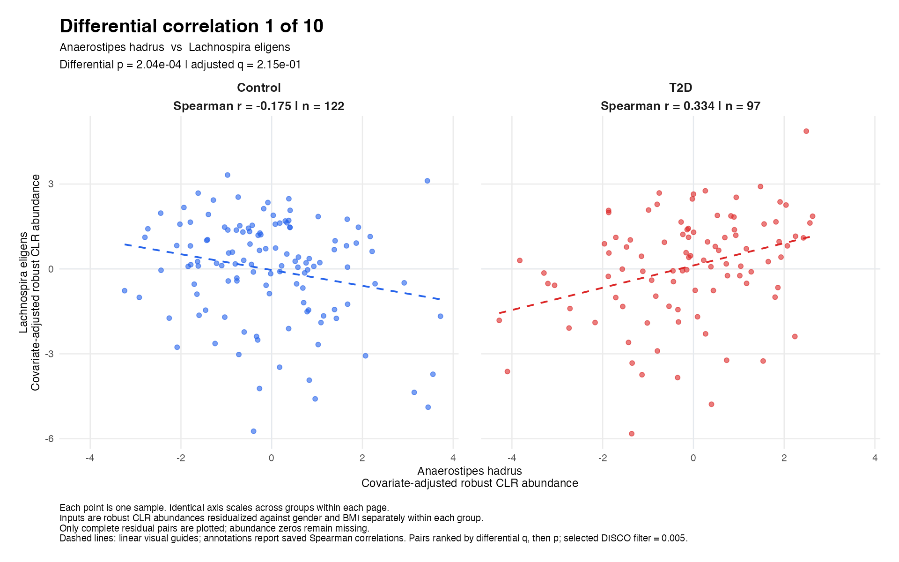
```

## Example of two data modalities: taxon–pathway correlations

The same T2D/control comparison now tests **taxon–pathway correlations**.
Taxa are the first modality, so DISCO assigns scores to taxa according to
changes in their relationships with pathways. Pathways are unstratified
community totals, excluding `UNMAPPED` and `UNINTEGRATED`.

Restrict both modalities to common usable participants, then repeat the
≥`r example_prevalence`% per-group prevalence filter and robust CLR separately
for taxa and pathways. Adjust **both modalities** for gender and BMI in separate
control and T2D models, preserving missing values throughout.

```{r run-two-modalities, eval=FALSE}
```

### DISCO results

```{r two-cohort, echo=FALSE}
knitr::kable(readme_results$taxa_pathways$cohort, row.names = FALSE)
```

**`r readme_results$taxa_pathways$significant_taxa` taxa have DISCO q <
`r example_q`.** The table lists all significant taxa, using the same columns
and ordering as the one-modality analysis. Here, “Pairs” counts contributing
taxon–pathway pairs.

```{r two-top, echo=FALSE}
disco_taxa_table(example_results$taxa_pathways$disco)
```

### Diagnostics for threshold selection

The global permutation p-value is
**`r format(readme_results$taxa_pathways$global_test$global_p_value, digits=4)`**;
the selected threshold is **`r readme_results$taxa_pathways$selected_threshold`**.
`r if (readme_results$taxa_pathways$global_test$signal_detected) "The global test passes and DISCO selects the threshold using the real-to-null discovery ratio." else "The global test does not pass, so DISCO uses the fallback threshold of 1."`
These diagnostics are calculated independently for the taxon–pathway analysis.

```{r two-discoveries, echo=FALSE, out.width="100%"}
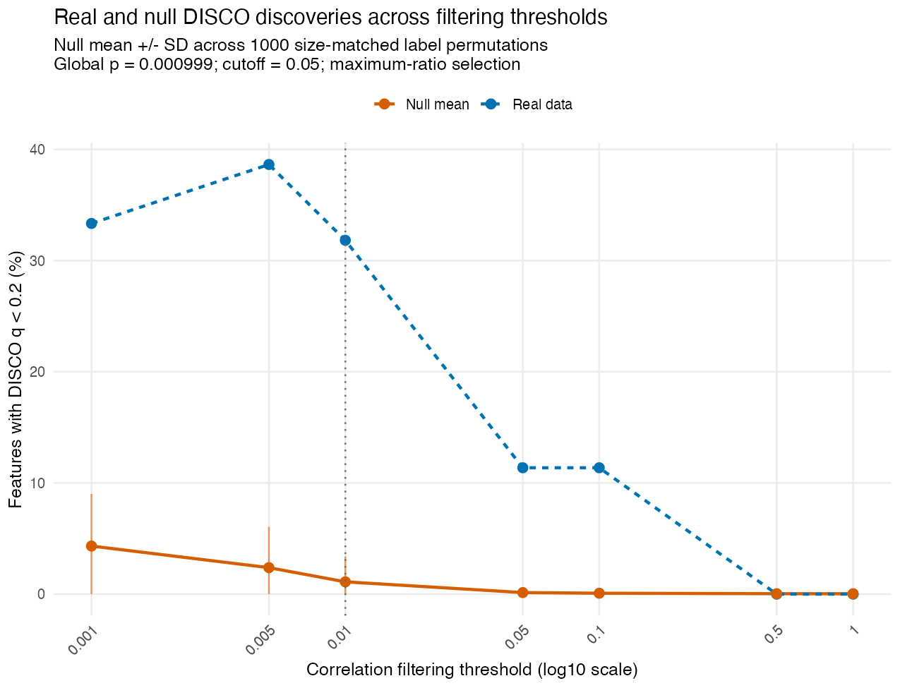
```

```{r two-ratios, echo=FALSE, out.width="100%"}
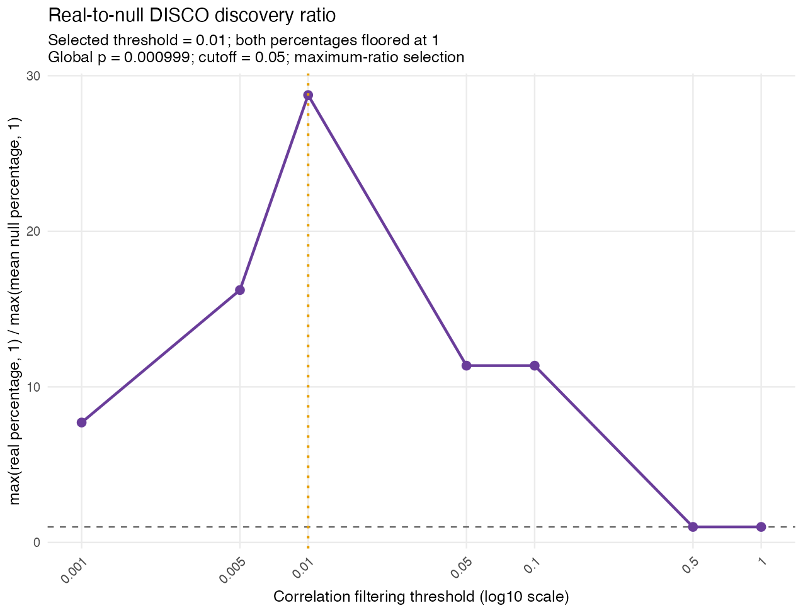
```

```{r two-features, echo=FALSE, out.width="100%"}
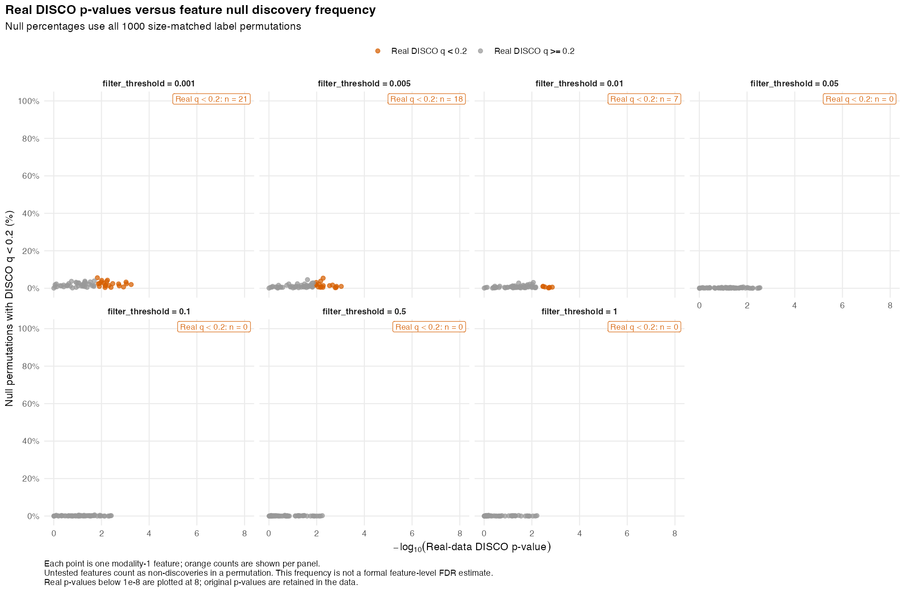
```

### Taxon–pathway network

The following bipartite network links the **top five significant DISCO taxa** to pathways
with **raw differential-correlation p < 0.05**, using the saved filtered pair
table. Gold nodes are taxa and grey nodes are pathways. Pathways are labelled
by their IDs; full names are exported in
[network_nodes.csv](https://github.com/FarnazFouladi/DISCO/blob/main/analysis/diabetes_microbiome/results/taxa_pathway_networks/network_nodes.csv).
Both panels use identical nodes, edges, and positions. Edge colors and widths
show the group-specific Spearman correlations, as in the taxa-only network.

Correlation source:
[QinJ_2012_taxa_pathways_cor_diff.csv](https://github.com/FarnazFouladi/DISCO/blob/main/analysis/diabetes_microbiome/results/taxa_pathways/QinJ_2012_taxa_pathways_cor_diff.csv).
Here `t1` is the taxon and `t2` is the pathway; `r1`/`r2`, `n1`/`n2`, and
`p`/`q` have the same meanings as in the taxa-only pair table. The exact plotted
edge subset is exported in
[network_edges.csv](https://github.com/FarnazFouladi/DISCO/blob/main/analysis/diabetes_microbiome/results/taxa_pathway_networks/network_edges.csv).

```{r two-network, echo=FALSE, out.width="100%"}
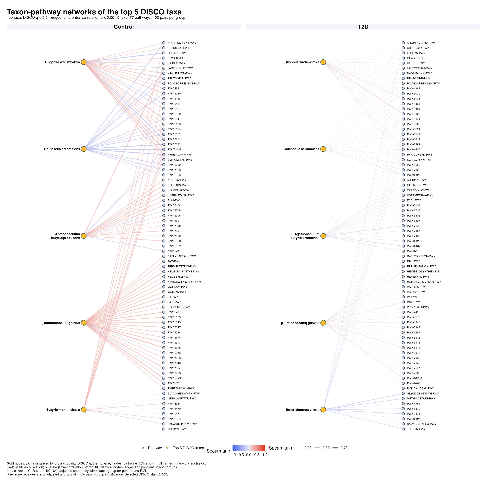
```

### Example pairwise scatterplot

The highest-ranked retained pair is **`r example_pairs$taxa_pathways$t1[1]` versus
`r sub(":.*$", "", example_pairs$taxa_pathways$t2[1])`**
(`r sub("^[^:]+: *", "", example_pairs$taxa_pathways$t2[1])`). The plotted values
are the separately adjusted robust CLR taxon and pathway measurements, with
complete pairs only. Saved group-specific Spearman correlations, sample counts,
and pair-level differential-correlation p-values and q-values are shown;
dashed lines remain visual guides.

Pair statistics come from
[QinJ_2012_taxa_pathways_cor_diff.csv](https://github.com/FarnazFouladi/DISCO/blob/main/analysis/diabetes_microbiome/results/taxa_pathways/QinJ_2012_taxa_pathways_cor_diff.csv).
The selected example and its annotations are saved in
[top1_pairs.csv](https://github.com/FarnazFouladi/DISCO/blob/main/analysis/diabetes_microbiome/results/taxa_pathway_scatterplots/top1_pairs.csv), and its
sample values are exported in
[scatterplot_data.csv](https://github.com/FarnazFouladi/DISCO/blob/main/analysis/diabetes_microbiome/results/taxa_pathway_scatterplots/scatterplot_data.csv).
Those values are extracted from the adjusted taxon and pathway matrices in
[disco_inputs.rds](https://github.com/FarnazFouladi/DISCO/blob/main/analysis/diabetes_microbiome/results/taxa_pathways/disco_inputs.rds).

```{r two-scatterplot, echo=FALSE, out.width="100%"}
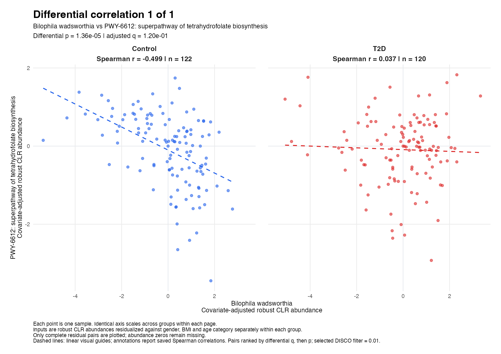
```

## Overall microbiome example results

Across the two analyses, **`r example_union` unique taxa** have DISCO q < `r example_q`
in at least one analysis: `r length(example_significant$taxa)` in taxa–taxa DISCO,
`r length(example_significant$taxa_pathways)` in taxon–pathway DISCO, and
`r example_overlap` in both. The heatmap compares the **raw feature-level DISCO p-values** for this
union, including each taxon's nonsignificant result in the other column.

Colors show **−log10(raw DISCO p)** without row scaling. An asterisk marks
**DISCO q < `r example_q`** in that cell. Rows with both results are hierarchically clustered by
Euclidean distance on the displayed values using complete linkage. Taxa without
a testable result in one analysis are shown in a separate unclustered block,
with unavailable values grey; no p-values are imputed. The two analysis columns
stay in a fixed order. Thus the stars summarize adjusted
significance, while the colors retain the raw p-value magnitude.

```{r overall-heatmap, echo=FALSE, out.width="100%"}
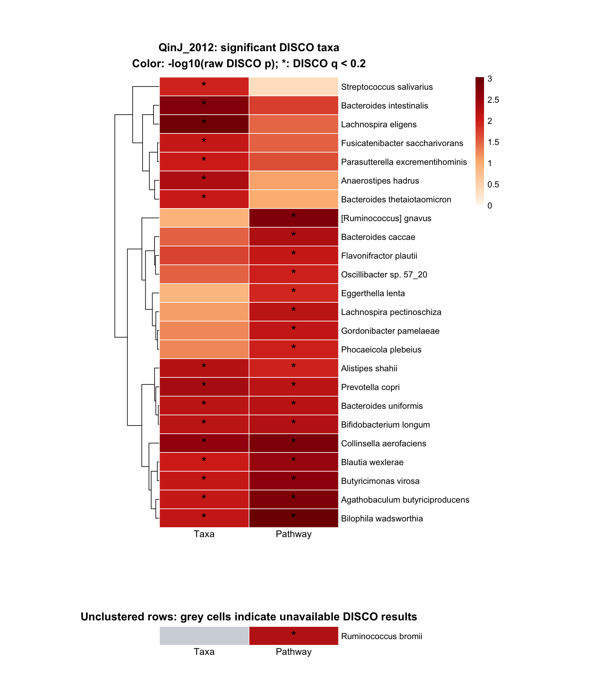
```

### Run the microbiome examples

Install DISCO as shown above, then clone this repository or download its GitHub
ZIP to obtain the example scripts (they are not included in the installed package).
Run the following commands from the repository root.

Install the example dependencies in R:

```{r rebuild-dependencies, eval=FALSE}
install.packages(c("BiocManager", "igraph", "ggrepel", "pheatmap", "rmarkdown", "knitr"))
BiocManager::install(c("curatedMetagenomicData", "SummarizedExperiment"))
```

Rerun the analysis and generate the plots:

```sh
Rscript analysis/diabetes_microbiome/code/run_qinj_readme_examples.R
Rscript analysis/diabetes_microbiome/code/plot_qinj_taxa_networks.R
Rscript analysis/diabetes_microbiome/code/plot_qinj_top_differential_scatterplots.R
Rscript analysis/diabetes_microbiome/code/plot_qinj_taxa_pathway_networks.R
Rscript analysis/diabetes_microbiome/code/plot_qinj_top_taxa_pathway_scatterplots.R
Rscript analysis/diabetes_microbiome/code/plot_qinj_disco_heatmap.R
```

The analysis uses `library(DISCO)` and saves results in
`analysis/diabetes_microbiome/results/`. Adjust `settings` in the analysis script as
needed. Each run replaces the previous results. Each script also supports
`source()` with its full path.

## Transcriptomics example: gene correlations within IBD Hallmark pathways

This example uses diagnostic **ileal biopsy RNA-seq** from
[GSE57945 / SRP042228](https://www.ncbi.nlm.nih.gov/geo/query/acc.cgi?acc=GSE57945),
reported by [Haberman et al. (2014)](https://doi.org/10.1172/JCI75436).
Expression measurements come from [recount3](https://rna.recount.bio/) with **GENCODE v26** annotation.
All samples are ileal biopsies, including those from patients with colon-only
disease. The comparisons below reuse the same non-IBD controls:

```{r ibd-sample-counts, echo=FALSE}
knitr::kable(ibd_sample_table, row.names = FALSE)
```

Here, DISCO scores **genes within each pathway**, based on changes in their
correlations with other genes in that pathway. It does not test differential
expression or assign a pathway enrichment p-value. The goal here is to identify
pathways that have the highest percentage of disrupted genes (genes with DISCO q < `r ibd_q`).

### Preprocessing and analysis

Before running DISCO, the RNA-seq data are preprocessed as follows:

1. Match GEO sample metadata to the recount3 expression data using sample
   identifiers. Require complete age-at-diagnosis and sex information, and
   require unique patient identifiers.
2. Convert recount3 coverage sums to rounded read counts by dividing each
   sample by its average mapped read length. Resolve annotation-redundant
   gene pairs using the saved GENCODE exon-overlap audit: prefer the sole
   Hallmark member, otherwise the longer exon union, breaking ties by gene ID.
3. Filter expression once across all four groups with `edgeR::filterByExpr()`
   (`min.count = 10`, `min.total.count = 15`, `large.n = 10`, `min.prop = 0.7`).
   Apply TMM normalization and calculate log2 counts per million with
   `prior.count = 2`.
4. Use `limma::removeBatchEffect()` to adjust for centered age-at-diagnosis
   and sex while preserving the four group effects. Keep genes with finite
   adjusted variance greater than `1e-10` in every group. No batch adjustment
   is applied because batch identifiers are unavailable.
5. Select Hallmark sets from **MSigDB `r paste(ibd_provenance$msigdb_version, collapse = ", ")`** with at least
   **`r ibd_settings$min_pathway_genes` unique database gene symbols before expression filtering**
   (`r ibd_n_pathways` sets). Map gene IDs
   to each set and run one-modality DISCO separately for each disease/control
   comparison and pathway, using the same jointly preprocessed expression.

The DISCO call inside the pathway runner is equivalent to the following,
where `expr` contains the eligible genes for one pathway in rows and the
comparison's samples in columns, and `group` labels those columns:

```{r ibd-disco-call, eval=FALSE}
result <- disco(
  data1 = list(t(expr[, group == "Control", drop = FALSE])),
  data2 = list(t(expr[, group == "Disease", drop = FALSE])),
  cooccur = 10L,
  empirically_derive_threshold = FALSE,
  filter_threshold = 1,
  adj_method = "BY",
  output_dir = "ibd_pathway_results",
  prefix = "pathway"
)
```

### Hallmark disrupted-gene percentages

BY adjustment is performed separately within each pathway and comparison;
genes with **DISCO q < `r ibd_q`** are counted as significant. Pathways can share
genes, and the comparisons share controls.

The figure below uses the current saved results.
Each bar shows **100 × significant genes / tested genes**, excluding genes
without a finite within-pathway q-value. The same **`r ibd_n_displayed` pathways** are displayed
in every facet: those with at least `r ibd_plot_settings$min_percent`% significant genes in any comparison.
Pathways are ordered from highest to lowest percentage in **iCD**, with the
same order in every facet. Facets show `r paste(ibd_comparisons, collapse = ", ")`
versus non-IBD controls. Alphabetical pathway names break ties in iCD percentages.

The results show that gene correlations are most disrupted in iCD, followed by
cCD, and least disrupted in UC. One potential explanation is that ileal biopsies
were used for gene expression measurements across all disease groups, and genes
in the ileum may not be affected in UC. In both iCD and cCD, the inflammatory
response and epithelial–mesenchymal transition pathways have the highest
percentages of disrupted genes.

```{r ibd-barplot, echo=FALSE, out.width="100%"}
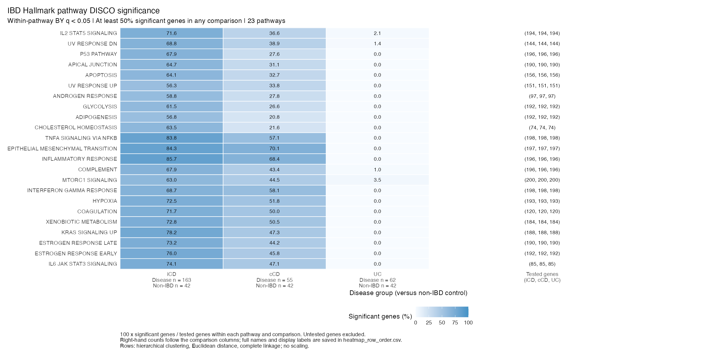
```

The figure is a descriptive summary of gene-level correlation disruption,
rather than a formal pathway significance test.

```{r ibd-inflammatory-example, echo=FALSE, results='asis'}
if (nrow(ibd_inflammation) && all(is.finite(ibd_inflammation$percent_significant))) {
  cat("For example, the inflammatory response pathway has ",
      paste(sprintf("%.1f%% in %s", ibd_inflammation$percent_significant,
                    ibd_inflammation$comparison), collapse = ", "),
      " significant tested genes.\n", sep = "")
}
```

The bundled [gene scores](https://github.com/FarnazFouladi/DISCO/blob/main/analysis/ibd_transcriptomics/results/all_pathway_gene_scores.csv),
[sample counts](https://github.com/FarnazFouladi/DISCO/blob/main/analysis/ibd_transcriptomics/results/comparison_sample_counts.csv),
[disrupted-gene percentages](https://github.com/FarnazFouladi/DISCO/blob/main/analysis/ibd_transcriptomics/results/figure/pathway_significance_percentages.csv),
and [pathway order](https://github.com/FarnazFouladi/DISCO/blob/main/analysis/ibd_transcriptomics/results/figure/pathway_order.csv)
allow inspection without rerunning the analysis.

The saved [provenance](https://github.com/FarnazFouladi/DISCO/blob/main/analysis/ibd_transcriptomics/results/provenance.rds)
and [session information](https://github.com/FarnazFouladi/DISCO/blob/main/analysis/ibd_transcriptomics/results/session_info.txt)
record the analysis settings and software versions.

### Run the workflow

Clone or download this repository and run from its root. The
[example script](https://github.com/FarnazFouladi/DISCO/blob/main/analysis/ibd_transcriptomics/code/example_ibd_workflow.R),
supporting helpers, audited metadata, and reference snapshots are included
under `analysis/ibd_transcriptomics/`; the expression count download is separate.
These files are not part of the installed R package.

The scripts run in the following order, all under
`analysis/ibd_transcriptomics/code/`:

The repository already includes `sample_metadata.csv` and
`raw/recount_metadata.rds` under
`analysis/ibd_transcriptomics/results/inputs/`. The last column indicates
whether each script is required when using these included metadata files.

| Order | Script | Purpose | Required when using the included metadata files? |
|---|---|---|---|
| 1 | `fetch_srp042228_metadata.R` | Download GEO, recount3, and ENA sample metadata. | No |
| 2 | `explore_srp042228_metadata.R` | Check sample/patient identifiers, disease labels, and GEO/recount3 agreement; write `sample_metadata.csv`. | No |
| 3 | `fetch_srp042228_counts.R` | Download the recount3 gene coverage sums. | Yes, once |
| 4 | `run_ibd_hallmark_disco.R` | Match metadata to expression columns, preprocess expression, and run pathway DISCO. | Yes |
| 5 | `plot_ibd_hallmark_significance.R` | Plot significant-gene percentages from the completed results. | Yes, to generate the bar plot |

`example_ibd_workflow.R` configures and runs **steps 4 and 5** together; it is
an alternative to running those scripts separately. The `ibd_*_helpers.R`
files are loaded automatically and do not need to be run separately.

The metadata-to-expression matching in step 4 is performed by
`ibd_load_count_inputs()` in `ibd_hallmark_disco_helpers.R`. It matches GEO
accessions (`gsm`) to recount3's `sra.sample_name`, assigns the corresponding
run identifiers (`external_id`), and checks that expression columns follow
the same sample order. Step 2 creates and checks the metadata table before
this expression matching occurs.

Install the example dependencies:

```{r ibd-dependencies, eval=FALSE}
install.packages(c("BiocManager", "curl"))
BiocManager::install(c("recount3", "edgeR", "limma"))
```

**Skip steps 1–2 when using the included metadata files.** To download and
check fresh metadata instead, run these steps with a separate output directory:

```sh
# 1. Download metadata
Rscript analysis/ibd_transcriptomics/code/fetch_srp042228_metadata.R analysis/ibd_transcriptomics/results/metadata_refresh
# 2. Check metadata and create sample_metadata.csv
Rscript analysis/ibd_transcriptomics/code/explore_srp042228_metadata.R analysis/ibd_transcriptomics/results/metadata_refresh
```

If using this refreshed metadata, pass
`analysis/ibd_transcriptomics/results/metadata_refresh` to the count downloader
in step 3 and use the same path for `ibd.exploration_dir` in step 4. Freshly
retrieved data may differ from the snapshots used for the bundled figure.

**Step 3.** Download the recount3 gene counts once (an existing download is reused).
Using the bundled metadata:

```sh
Rscript analysis/ibd_transcriptomics/code/fetch_srp042228_counts.R analysis/ibd_transcriptomics/results/inputs
```

**Step 4.** Configure and run the Hallmark pathways for the disease/control comparisons:

```{r ibd-workflow, eval=FALSE}
```

The runner replaces the previous results in
`analysis/ibd_transcriptomics/results/`, including prepared expression matrices,
gene eligibility audits, DISCO tables, sample counts, and provenance. To try
just one pathway, set
`ibd.pathway_names = "HALLMARK_TNFA_SIGNALING_VIA_NFKB"` in the options above.
Fixed-threshold mode skips permutations, so `ibd.disco_workers` has no effect.

**Step 5.** Generate the bar plot with `plot_ibd_hallmark_significance.R`:

```{r ibd-plot, eval=FALSE}
```

To redraw the bar plot from
these saved results, set
`ibd_results_dir <- "analysis/ibd_transcriptomics/results"` before the plotting
chunk.

## Citation

If you use DISCO, please cite the paper that introduced the method:

Fouladi F, Chen Y, Bera S, Jarmusch AK, Van Tyne D, Palella FJ, Margolick JB, Chew KW, Sun J, Martinson J, Rinaldo CR, Peddada SD. A taxon-specific measurement of disruption in a multi-modal study of microbiomes and metabolomes reveals system-wide dysbiosis preceding HIV-1 infection. Nat Commun. 2025 Nov 20;16(1):10204. [doi:10.1038/s41467-025-64822-z](https://doi.org/10.1038/s41467-025-64822-z). PMID: 41266305; PMCID: PMC12635353.
