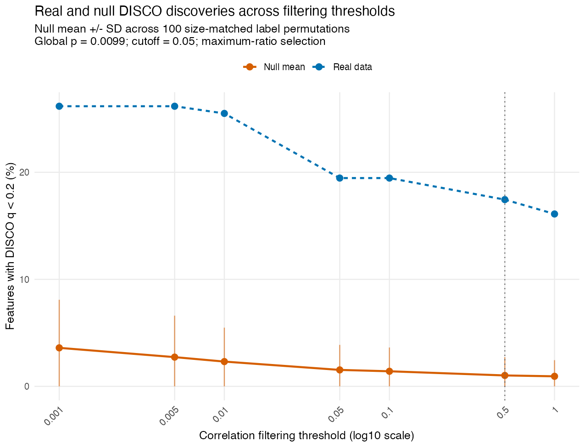
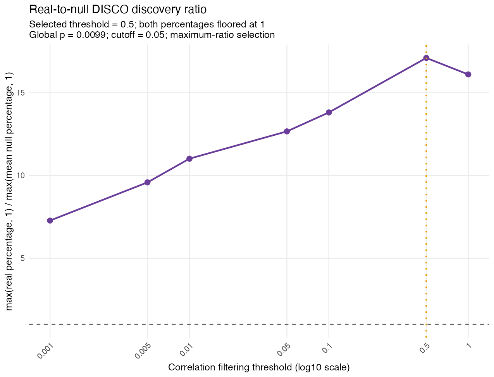
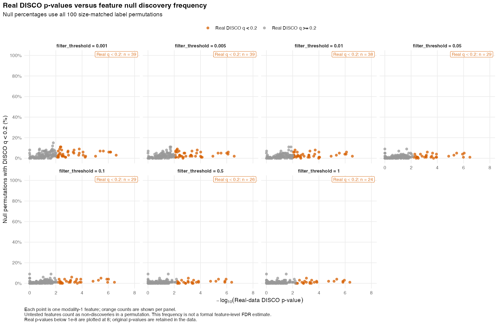
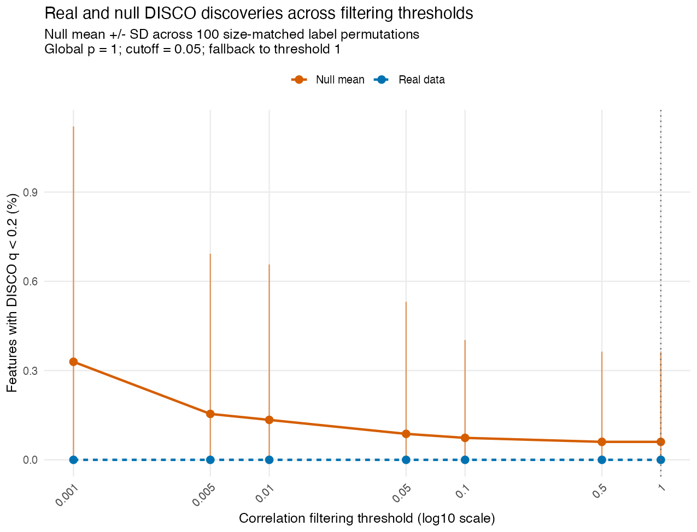
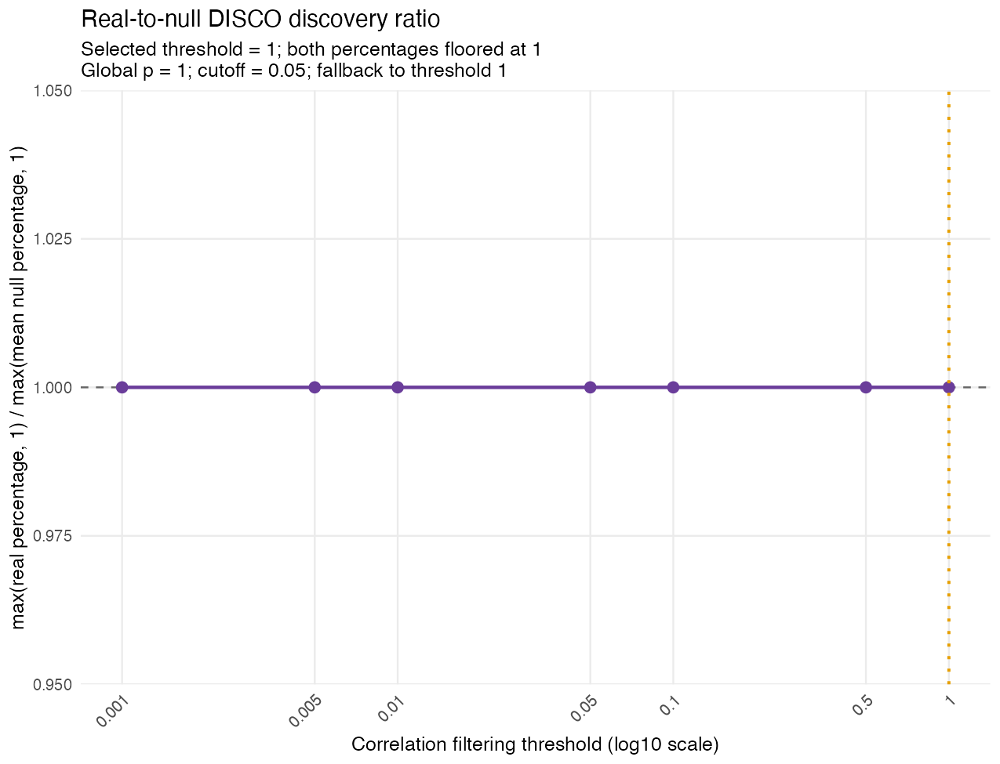
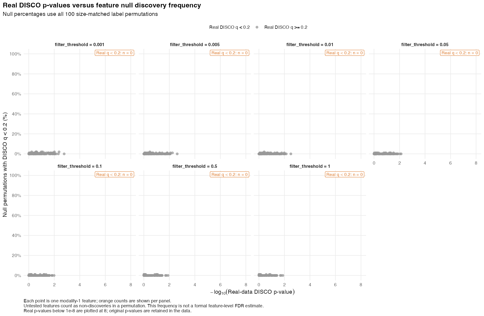

# DISCO

<!-- README.md is generated from README.Rmd. Please edit README.Rmd. -->

DISCO (**DIS**ruption in **CO**rrelations) identifies features whose
correlation patterns differ between two groups. It evaluates
relationships within one data modality or between two modalities and
combines pairwise tests into a feature-level DISCO score.

DISCO can be applied to **any high-dimensional data represented by
quantitative features**, including microbial abundances, gene
expression, proteins, and metabolites. It uses Spearman correlations
with Bonett–Wright standard errors and Cauchy combination of
differential-correlation p-values.

## Installation

``` r
install.packages("remotes") # If needed
remotes::install_github("FarnazFouladi/DISCO")
library(DISCO)
```

To use a local checkout during development, run
`devtools::load_all(".")` from the repository root.

## Inputs and arguments

`data1` and `data2` represent the two groups. Each is a list containing
one or two numeric matrices or data frames, with **samples in rows and
features in columns**. Supply unique feature names and, especially for
two modalities, unique sample row names. Corresponding modalities are
restricted to common features and put in a consistent order.

**Normalize inputs appropriately for the data type before running
DISCO.** The function does not normalize or adjust for covariates. CLR
is used for the compositional abundance examples below; other data types
require their own appropriate preprocessing. Supply covariate-adjusted
data if your analysis requires it. Zeros are observed values; only `NA`
reduces the pairwise-complete sample count.

| Argument | Default | Meaning |
|----|---:|----|
| `cooccur` | `10` | Minimum pairwise non-missing observations in **each** group; integer ≥4. |
| `empirically_derive_threshold` | `TRUE` | Select the correlation filtering threshold using label permutations. |
| `filter_threshold` | `0.05` | Fixed correlation p-value threshold when empirical selection is disabled. |
| `q_value` | `0.2` | Feature-level DISCO q cutoff for real and null discovery counts and plot colors. |
| `global_p_cutoff` | `0.05` | Global permutation p-value must be below this cutoff to select by ratio; otherwise use threshold `1`. |
| `n_resamples` | `100` | Number of size-matched label permutations. |
| `random_seed` | `1L` | Reproducible permutation seed; the caller’s RNG state is restored. |
| `adj_method` | `"BY"` | Multiple-testing adjustment passed to `p.adjust()`. |
| `output_dir`, `prefix` | Required | Results directory and filename prefix. |

Empirical mode evaluates `c(0.001, 0.005, 0.01, 0.05, 0.1, 0.5, 1)`. A
pair passes a threshold when its correlation p-value is below it in at
least one group. DISCO first compares the maximum real discovery
percentage across thresholds with the maximum from each permutation:

``` text
global p = (1 + number of null maxima >= real maximum) / (1 + valid permutations)
```

If the global test passes, DISCO selects the threshold maximizing
`max(real %, 1) / max(mean null %, 1)`; ties select the largest
threshold. Otherwise it uses threshold `1`. With 100 permutations, the
smallest possible global p-value is `1/101`. Thresholds without a real
discovery percentage are excluded from both maxima; permutations missing
any remaining threshold are excluded from the global test. Counts used
are reported in `global_test`. The function stops if no thresholds or
valid permutations remain.

For a fixed threshold, set `empirically_derive_threshold = FALSE` and
supply `filter_threshold`. This skips permutations and diagnostic plots.

## Returned results

| Component | Contents |
|----|----|
| `cor_diff` | Feature pairs, correlations `r1`/`r2`, counts `n1`/`n2`, and differential-correlation `p`/`q`, sorted by increasing `q`. |
| `disco` | Feature-level scores (`t`), p-values, q-values, and comparison counts (`num_corr`), sorted by increasing `q`. |
| `selected_threshold` | Selected empirical threshold or supplied fixed threshold. |
| `global_test` | Global p-value, cutoff, signal decision, permutation counts, and selected threshold. |
| `threshold_summary` | Real/null discovery percentages, null SD, floored percentages, and ratios across thresholds. |
| `discovery_plot`, `ratio_plot` | Real versus null discovery curves and their ratio. |
| `feature_null_summary`, `feature_null_plot` | Per-feature null discovery frequencies versus real p-values, across thresholds. |
| `output_files` | Paths to saved CSV tables and PNG figures. |

In two-modality mode, DISCO tests **cross-modality pairs** and scores
features in the **first modality**. Samples may differ between
modalities; permutations preserve each modality’s group sizes and
overlap. A shared sample receives one shuffled label for both
modalities.

In `feature_null_summary`, `q_less_than_0.2` indicates a real-data DISCO
`q < 0.2`; its name follows `q_value`. Null discovery percentages use
all permutations as the denominator, counting untested features as
non-discoveries. These frequencies are not formal feature-level FDR
estimates. The plots display real p-values below `1e-8` at
`-log10(p) = 8`; original p-values are retained. The global test
accounts for searching across thresholds but does not adjust
feature-level q-values for threshold selection.

Fixed mode returns the first three components and `output_files`; the
diagnostic components are `NULL`. Pair and feature tables are saved as
`<prefix>_cor_diff.csv` and `<prefix>_disco.csv`.

## Yachida example: taxa

We use healthy controls and CRC samples from [Yachida et
al. (2019)](https://www.nature.com/articles/s41591-019-0458-7), accessed
through
[curatedMetagenomicData](https://waldronlab.io/curatedMetagenomicData/reference/returnSamples.html).
This example uses:

- Relative abundances (`counts = FALSE`).
- Features present in **≥20% of samples across the combined CRC/control
  cohort**.
- Zero replacement with **half each feature’s minimum positive
  abundance**, estimated across that cohort after prevalence filtering.
- **CLR normalization** within each sample, separately for each
  modality.
- **No covariate adjustment**; these are exploratory results.
- 100 label permutations, `q_value = 0.2`, and `global_p_cutoff = 0.05`.

Install the example dependencies if needed:

``` r
install.packages("BiocManager")
BiocManager::install(c("curatedMetagenomicData", "SummarizedExperiment"))
```

### Retrieve and preprocess the data

``` r
library(DISCO)
library(curatedMetagenomicData)
library(SummarizedExperiment)

metadata <- sampleMetadata[
  !is.na(sampleMetadata$study_name) &
    sampleMetadata$study_name == "YachidaS_2019" &
    sampleMetadata$disease %in% c("healthy", "CRC"),
  , drop = FALSE
]
taxa_se <- returnSamples(
  metadata, dataType = "relative_abundance", counts = FALSE, rownames = "short"
)
taxa <- t(as.matrix(assay(taxa_se)))
sample_ids <- metadata$sample_id[metadata$sample_id %in% rownames(taxa)]
taxa <- taxa[sample_ids, , drop = FALSE]
taxa <- taxa[rowSums(taxa) > 0, , drop = FALSE]
group <- setNames(as.character(metadata$disease), metadata$sample_id)
taxa_group <- group[rownames(taxa)]
```

The same preprocessing helper is used for taxa and pathways:

``` r
# Samples are rows; features are columns. Apply independently per modality.
preprocess_abundance <- function(x, prevalence_cutoff = 0.20) {
  stopifnot(
    is.matrix(x), is.numeric(x), nrow(x) > 0L, ncol(x) > 0L,
    all(is.finite(x)), all(x >= 0), all(rowSums(x) > 0),
    !is.null(rownames(x)), !anyDuplicated(rownames(x)),
    !is.null(colnames(x)), !anyDuplicated(colnames(x)),
    length(prevalence_cutoff) == 1L, is.finite(prevalence_cutoff),
    prevalence_cutoff > 0, prevalence_cutoff <= 1
  )

  # Convert the full profile to proportions, then filter across both groups.
  x <- sweep(x, 1, rowSums(x), "/")
  prevalence <- colMeans(x > 0)
  keep <- prevalence >= prevalence_cutoff
  if (sum(keep) < 2L) stop("Fewer than two features pass the prevalence filter.")
  retained <- x[, keep, drop = FALSE]

  # One half-minimum per feature, estimated across the combined cohort.
  half_min <- apply(retained, 2, function(z) min(z[z > 0]) / 2)
  imputed <- retained
  zero_positions <- which(imputed == 0, arr.ind = TRUE)
  if (nrow(zero_positions) > 0L) {
    imputed[zero_positions] <- half_min[zero_positions[, "col"]]
  }
  log_x <- log(imputed)
  clr <- sweep(log_x, 1, rowMeans(log_x), "-")

  list(
    clr = clr,
    retained_relative_abundance = retained,
    imputed_abundance = imputed,
    prevalence = data.frame(
      feature = names(prevalence), prevalence = unname(prevalence), retained = keep
    ),
    half_minimum = data.frame(feature = names(half_min), replacement = unname(half_min))
  )
}
```

``` r
taxa_prepared <- preprocess_abundance(taxa, prevalence_cutoff = 0.20)
taxa_result <- disco(
  data1 = list(taxa_prepared$clr[taxa_group == "healthy", , drop = FALSE]),
  data2 = list(taxa_prepared$clr[taxa_group == "CRC", , drop = FALSE]),
  n_resamples = 100, random_seed = 1L,
  q_value = 0.2, global_p_cutoff = 0.05,
  output_dir = "analysis/yachida_readme_taxa_results",
  prefix = "YachidaS_2019_taxa"
)
taxa_result$global_test
taxa_result$selected_threshold
head(taxa_result$disco[order(taxa_result$disco$q, taxa_result$disco$p), ], 10)
```

### Results

These outputs come from the completed analysis, saved before rendering
this README. Package version: 0.0.0.9000; curatedMetagenomicData
version: 3.12.0. Downloading a different resource version can change
results.

| control | CRC | retained_taxa |
|--------:|----:|--------------:|
|     246 | 258 |           149 |

Global p-value: **0.009901**. Selected threshold: **0.5**. Taxa with
DISCO q \<0.2 at the selected threshold: **26**.

Top 10 taxa by DISCO q-value, breaking ties by p-value:

| Taxon                          | DISCO p  | DISCO q  | Comparisons |
|:-------------------------------|:---------|:---------|------------:|
| Parvimonas micra               | 4.22e-07 | 2.91e-04 |         142 |
| Actinomyces sp. HMSC035G02     | 1.12e-06 | 2.91e-04 |         145 |
| Tyzzerella nexilis             | 1.39e-06 | 2.91e-04 |         139 |
| \[Eubacterium\] sulci          | 1.40e-06 | 2.91e-04 |         140 |
| Fusobacterium mortiferum       | 4.25e-06 | 7.07e-04 |         144 |
| Megasphaera micronuciformis    | 6.69e-06 | 9.28e-04 |         141 |
| Actinomyces sp. ICM47          | 1.71e-05 | 2.03e-03 |         138 |
| Blautia sp. CAG:257            | 1.41e-04 | 1.31e-02 |         146 |
| Actinomyces sp. oral taxon 181 | 1.42e-04 | 1.31e-02 |         140 |
| Butyricimonas synergistica     | 2.03e-04 | 1.69e-02 |         133 |

The first plot compares real discovery percentages with the null mean ±
SD. The second shows the ratio used to select the threshold.





Each point below is a taxon. Orange denotes real-data DISCO q \<0.2;
each panel reports its orange-taxon count. The y-axis is the percentage
of null permutations in which that taxon had DISCO q \<0.2.



## Yachida example: taxa and pathways

We now compare **taxon–pathway correlations** between CRC and healthy
controls. The first modality is taxa, so the DISCO scores describe taxa
whose relationships with pathways differ between groups. Pathways are
unstratified community totals; `UNMAPPED` and `UNINTEGRATED` rows are
removed. Both modalities are restricted to common usable samples, then
prevalence-filtered and normalized separately using the same ≥20%,
half-minimum, CLR workflow above. No covariate adjustment is applied.

``` r
pathway_se <- returnSamples(metadata, dataType = "pathway_abundance")
pathways <- t(as.matrix(assay(pathway_se)))
pathway_ids <- colnames(pathways)
pathways <- pathways[, !grepl("|", pathway_ids, fixed = TRUE) &
                       !toupper(trimws(pathway_ids)) %in% c("UNMAPPED", "UNINTEGRATED"),
                     drop = FALSE]
common_ids <- rownames(taxa)[rownames(taxa) %in% rownames(pathways)]
common_ids <- common_ids[rowSums(pathways[common_ids, , drop = FALSE]) > 0]
two_group <- group[common_ids]
two_taxa <- preprocess_abundance(taxa[common_ids, , drop = FALSE])
two_pathways <- preprocess_abundance(pathways[common_ids, , drop = FALSE])

two_result <- disco(
  data1 = list(two_taxa$clr[two_group == "healthy", , drop = FALSE],
               two_pathways$clr[two_group == "healthy", , drop = FALSE]),
  data2 = list(two_taxa$clr[two_group == "CRC", , drop = FALSE],
               two_pathways$clr[two_group == "CRC", , drop = FALSE]),
  n_resamples = 100, random_seed = 1L,
  q_value = 0.2, global_p_cutoff = 0.05,
  output_dir = "analysis/yachida_readme_two_modality_results",
  prefix = "YachidaS_2019_taxa_pathways"
)
two_result$global_test
two_result$selected_threshold
head(two_result$disco[order(two_result$disco$q, two_result$disco$p), ], 10)
```

### Results

| control | CRC | retained_taxa | retained_pathways |
|--------:|----:|--------------:|------------------:|
|     246 | 258 |           149 |               385 |

Global p-value: **1**. Selected threshold: **1**. Taxa with DISCO q
\<0.2 at the selected threshold: **0**.

The global test does not detect excess discoveries in this taxon–pathway
analysis, so DISCO falls back to threshold 1. The table below shows the
top 10 taxa by DISCO q-value, breaking ties by p-value. A ranking alone
does not establish significance; use the reported q-values.

| Taxon                          | DISCO p  | DISCO q | Comparisons |
|:-------------------------------|:---------|:--------|------------:|
| Mogibacterium diversum         | 1.33e-02 | 1e+00   |         385 |
| Odoribacter splanchnicus       | 1.80e-02 | 1e+00   |         385 |
| Bifidobacterium longum         | 2.11e-02 | 1e+00   |         385 |
| Enterocloster aldenensis       | 3.86e-02 | 1e+00   |         385 |
| Ruminococcus bromii            | 4.29e-02 | 1e+00   |         385 |
| Parvimonas micra               | 4.45e-02 | 1e+00   |         385 |
| Erysipelatoclostridium ramosum | 4.66e-02 | 1e+00   |         385 |
| Actinomyces sp. HMSC035G02     | 4.81e-02 | 1e+00   |         385 |
| Holdemanella biformis          | 5.39e-02 | 1e+00   |         385 |
| Adlercreutzia equolifaciens    | 5.40e-02 | 1e+00   |         385 |







## Rebuilding these examples

`README.Rmd` is the source for this README. Rendering reads the portable
saved summaries in `README-results.rds` and figures under
`man/figures/`; it does not download data or rerun permutations. From
the repository root:

``` r
install.packages(c("rmarkdown", "knitr")) # If needed; Pandoc is also required
rmarkdown::render("README.Rmd")
```

To regenerate the analysis outputs and README assets with the current
local package, run:

``` sh
Rscript analysis/run_yachida_readme_examples.R
```

This requires the example dependencies and `pkgload`, may download
resources through ExperimentHub, and reuses existing results only when
inputs and settings match. Set `DISCO_README_RECOMPUTE=true` to
recompute both examples. Full results stay under `analysis/`; the README
bundle contains only cohort summaries and top-result tables. Package
checks can be run with `devtools::test()` and `devtools::check()`.

## License

DISCO is licensed under the MIT License.
